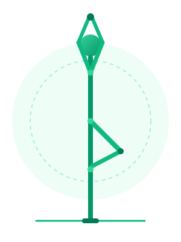
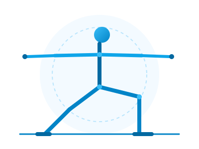
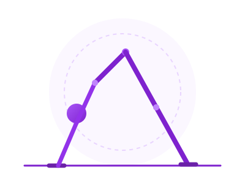

# PoseYoga 🧘‍♀️

> Intelligent, real-time browser yoga pose guidance and posture analysis powered by on-device MediaPipe AI.

PoseYoga is a modern web application built with React and Vite that provides interactive yoga practice with instant visual and audio posture corrections. All vision processing is executed 100% locally on your device using WebAssembly and WebGL—no webcam video or sensitive data ever leaves your computer.

---

## 🌐 Live Demo & Deployment

- **Live URL**: [https://poseyoga.vercel.app](https://poseyoga.vercel.app) *(Replace with your deployed production URL)*
- **Instant Demo Mode**: [https://poseyoga.vercel.app/?unlock=all](https://poseyoga.vercel.app/?unlock=all) *(Unlocks all 5 levels for live presentations)*
- **Webcam Calibration HUD**: [https://poseyoga.vercel.app/?debug=1](https://poseyoga.vercel.app/?debug=1) *(Displays live angles and tolerances)*

---

## 📸 Screenshots

| Practice Viewport & 60fps Skeleton | Real-Time Feedback & Guidance | Session Performance & Summary |
| :---: | :---: | :---: |
|  |  |  |
| *Aspect-ratio corrected skeleton overlay* | *Real-time hints and directional guidance* | *Continuous hold scoring and breakdown* |

---

## ✨ Features

- **On-Device Vision AI**: Powered by `@mediapipe/tasks-vision` running WebAssembly locally.
- **Aspect-Corrected Geometry**: Computes precise Euclidean joint angles in screen space, avoiding normalized aspect-ratio distortion.
- **Mirrored Side Detection**: Poses like Tree Pose and Warrior II automatically detect and score whichever leg or arm side you perform.
- **Pre-Flight Full Body Check**: Verifies that your full silhouette (head, shoulders, hips, knees, and ankles) is in view before timing begins, with intelligent relaxed framing for floor poses (Cobra, Downward Dog) so the Begin button is never blocked.
- **Hold Continuity Scoring**: Final score factors both posture alignment and hold consistency (`average similarity × fraction of hold time in pose`). Excessive wobbling or breaking posture lowers the final score and correctly triggers "Try Again".
- **Hold-Phase Timeout Guard**: Automatically concludes and scores attempts after $3\times$ the target duration if posture cannot be maintained, preventing infinite hold hangs.
- **Zero Latency Pose Status**: High-frequency frame callbacks feed the hold timer at native camera frame rates, avoiding 200ms throttle stutter.
- **Accurate Directional Feedback**: Natural language cues pointing in the correct anatomical direction (e.g., "Bend your front knee deeper", "Raise your left arm higher"), prioritized by relative error (`diff / tolerance`).
- **Non-Repeating Voice Guidance**: Speaks guidance once per unique alignment error, eliminating repetitive chatter while resetting when posture is corrected.
- **Self-Hosted Vector Illustrations & Icons**: High-resolution, offline SVG illustrations for every pose and full PWA icons (192px and 512px).
- **Progressive Curriculum & Persistence**: 5 curated poses with level gating, personal best tracking, and practice history stored locally in `localStorage`.
- **Accessible & Responsive**: High-contrast color tokens, keyboard navigation, visible focus indicators, and mobile-friendly layouts.

---

## 🗂️ Project Structure

```text
yoga-project/
├── .github/
│   └── workflows/
│       └── ci.yml                  # GitHub Actions CI workflow (npm ci, lint, test, build)
├── .gitignore                      # Root gitignore excluding dependencies and secrets
├── README.md                       # Repository documentation
├── netlify.toml                    # Netlify deployment configuration (base: Frontend/yoga-project)
└── Frontend/
    └── yoga-project/               # Core React application (Vite)
        ├── public/
        │   ├── icon-192.png        # PWA install icon (192x192)
        │   ├── icon-512.png        # PWA install icon (512x512)
        │   ├── favicon.svg         # Modern vector favicon
        │   ├── manifest.webmanifest# PWA web manifest
        │   ├── models/             # MediaPipe task models (cached for offline use)
        │   ├── poses/              # Self-hosted SVG pose illustrations
        │   └── wasm/               # Self-hosted MediaPipe WebAssembly binaries
        ├── scripts/
        │   ├── generate-icons.js   # Pure Node PNG icon generator
        │   └── setup-mediapipe.js  # Asset copying and model download postinstall script
        ├── src/
        │   ├── components/         # Clean React UI components
        │   │   ├── FinalScreen.jsx # Session summary, card export & confetti celebration
        │   │   ├── Landing.jsx     # Value proposition & curriculum selector
        │   │   ├── LevelScreen.jsx # Practice canvas, skeleton & real-time checklist
        │   │   ├── ScoreScreen.jsx # Animated score & joint breakdown
        │   │   └── SettingsModal.jsx # Camera, hold time, and difficulty controls
        │   ├── data/
        │   │   └── levels.js       # Target angles, tolerances, tips & benefits
        │   ├── hooks/              # Custom modular lifecycle hooks
        │   │   ├── useCamera.js    # Camera stream lifecycle & permission errors
        │   │   ├── useHoldTimer.js # Continuous hold timer with continuity tracking & timeout
        │   │   ├── usePoseLandmarker.js # MediaPipe pose detection pipeline
        │   │   └── useVoiceGuidance.js  # Web Speech synthesis
        │   ├── utils/
        │   │   ├── poseFeedback.js # Normalized hint prioritization & debounce
        │   │   ├── poseUtils.js    # Mathematical geometry & skeleton rendering
        │   │   ├── poseUtils.test.js # Unit tests for math and feedback logic
        │   │   ├── scoring.test.js # Unit tests for scoring, hold progress & persistence
        │   │   ├── soundEffects.js # Audio chime synthesis via Web Audio API
        │   │   └── storageUtils.js # Safe storage parsers and hold progress math
        │   ├── App.jsx             # Main application state orchestrator
        │   ├── index.css           # Modern design system & accessible styles
        │   └── main.jsx            # React root mount
        ├── .env.example            # Environment configuration template
        ├── eslint.config.js        # Modern ESLint configuration
        ├── package-lock.json       # Strict dependency lockfile for npm ci
        ├── package.json            # Scripts and dependencies
        ├── vercel.json             # Sub-directory Vercel rewrite configuration
        └── vite.config.js          # Vite build configuration
```

---

## 🚀 Quick Start

### 1. Prerequisites

- [Node.js](https://nodejs.org/) (version 20.19+ or 22+ recommended)
- A modern web browser (Chrome, Edge, Brave, Firefox, or Safari) with webcam access
- HTTPS context or `localhost` (required by browser security policies for webcam access)

### 2. Install Dependencies

Navigate into the frontend directory:

```bash
cd Frontend/yoga-project
npm install
```

> **Note**: The `postinstall` script will automatically copy `@mediapipe/tasks-vision` WASM assets to `public/wasm/` and download `pose_landmarker_lite.task` to `public/models/` for offline capability. If internet access is restricted during install, the browser will seamlessly fall back to the pinned jsDelivr CDN version when online.

### 3. Run Development Server

```bash
npm run dev
```

Open your browser to `http://localhost:5173`.

### 4. Build for Production

```bash
npm run build
```

The compiled SPA bundle will be generated in `Frontend/yoga-project/dist/`.

---

## 🧪 Testing & Code Quality

Run all test suites (using Node.js built-in native test runner `node --test`):

```bash
npm run test
```

Run static analysis and linting:

```bash
npm run lint
```

---

## 🛠️ Demo & Calibration Shortcuts

- **Instant Demo Unlock**: Append `?unlock=all` to the URL (e.g., `http://localhost:5173/?unlock=all`) to immediately unlock all 5 curriculum levels for seamless live presentations.
- **Live Calibration HUD**: Append `?debug=1` to any URL or set `VITE_ENABLE_DEBUG=true` in `.env.local` to open an on-screen engineering HUD displaying live joint angles, targets, diffs, tolerances, and a one-click **Copy Angles JSON** button for pose calibration.

---

## 🔒 Privacy & Permissions

- **100% Local Inference**: Video frames are captured directly by your browser and processed in-memory using WebAssembly and WebGL. No image or video stream is ever transmitted over the network or saved to any server.
- **HTTPS Requirement**: Modern browsers require an encrypted context (`https://` or `localhost`) to grant webcam access.

---

## ⚠️ Yoga & Safety Guidance

PoseYoga's automated angle matching provides bio-mechanical estimations based on 2D camera projections for fitness and posture awareness. It does not constitute medical advice or guarantee injury-free practice. Always listen to your body, avoid forcing any joint beyond comfortable limits, and consult a certified yoga instructor or medical professional for personalized guidance.

---

## 📄 License

MIT License. Free for personal, educational, and commercial use.
